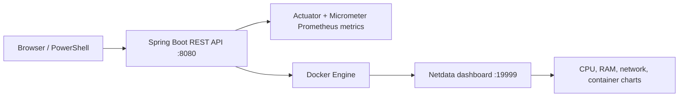

# Real-Time Application Monitoring & Observability Lab

A practical Spring Boot, Docker, and Netdata lab for safely seeing CPU, memory, latency, traffic, errors, and container health change in real time.



## What this demonstrates

- **Monitoring** answers *what is happening?* — for example, CPU rose or a container is unhealthy.
- **Observability** helps investigate *why?* — correlate container metrics with application metrics and logs.

Netdata gives strong real-time infrastructure and container visibility. This lab adds Spring Actuator, Prometheus-formatted metrics, and logs for basic application observability. Distributed tracing is a valuable next step, but is intentionally outside this 30-minute lab.

## Prerequisites

- Docker Desktop with Docker Compose
- Java 21 and Maven only if running outside Docker

> On Windows with Docker Desktop, Netdata host charts commonly describe Docker's Linux VM, not the whole Windows host. Container charts remain the relevant view for this lab.

## Quick start

```powershell
docker compose up --build -d
.\scripts\smoke-test.ps1
```

Open:

- API: <http://localhost:8080/api/hello>
- Health: <http://localhost:8080/actuator/health>
- Prometheus metrics: <http://localhost:8080/actuator/prometheus>
- Netdata: <http://localhost:19999>

Stop the lab when finished:

```powershell
docker compose down
```

## API experiments

| Endpoint | Purpose | Safe bound |
|---|---|---|
| `/api/hello` | Normal JSON response | n/a |
| `/api/health-check` | Application availability | n/a |
| `/api/cpu?seconds=10` | CPU spike | 1–30 seconds |
| `/api/memory?mb=100&seconds=15` | Temporary memory allocation | 1–200 MB, 1–30 seconds |
| `/api/slow?delayMs=2000` | Slow response | 0–10,000 ms |
| `/api/error` | Intentional HTTP 500 | local learning only |

These endpoints are deliberately bounded and designed for local practice only. Do not expose them on a public environment.

## 30-minute practical tutorial

### 0–5 minutes — Start and verify

Run `docker compose up --build -d`, then `.\scripts\smoke-test.ps1`. Confirm `/actuator/health` returns `UP` and Netdata opens.

### 5–10 minutes — Explore infrastructure monitoring

In Netdata, search for the `monitoring-demo` container. Inspect its CPU, memory, network traffic, and status charts. These are infrastructure and container monitoring signals.

### 10–15 minutes — Inspect application signals

Open `/actuator/metrics` and `/actuator/prometheus`. Search the latter for `http_server_requests`, `jvm_memory_used_bytes`, `jvm_threads_live_threads`, and `process_cpu_usage`.

### 15–20 minutes — Trigger resource spikes

```powershell
Invoke-WebRequest "http://localhost:8080/api/cpu?seconds=10"
Invoke-WebRequest "http://localhost:8080/api/memory?mb=100&seconds=10"
```

Expected: CPU then memory charts rise in Netdata. Compare that timing with `process_cpu_usage` and `jvm_memory_used_bytes` at the Prometheus endpoint. Conclusion: the container metric identifies the resource pressure; JVM metrics narrow it to the app process.

### 20–25 minutes — Create latency, traffic, and errors

```powershell
.\scripts\generate-traffic.ps1 -Seconds 30
Invoke-WebRequest "http://localhost:8080/api/slow?delayMs=3000"
Invoke-WebRequest "http://localhost:8080/api/error"
```

Expected: HTTP duration/count metrics change, normal traffic increases network activity, and the last call returns 500. Inspect `http_server_requests_seconds` in Prometheus and application logs with `docker compose logs app --tail 50`. Conclusion: metrics say a request is slow or failing; endpoint-aware metrics and logs explain which experiment caused it.

### 25–30 minutes — Run the complete lab and document it

```powershell
.\scripts\run-experiments.ps1
```

Capture the dashboard during CPU and memory load, then write what changed, when it changed, and which API call caused it.

For macOS/Linux, replace PowerShell calls with:

```bash
curl http://localhost:8080/actuator/health
curl 'http://localhost:8080/api/cpu?seconds=10'
curl 'http://localhost:8080/api/memory?mb=100&seconds=10'
curl 'http://localhost:8080/api/slow?delayMs=3000'
curl -i http://localhost:8080/api/error
```

## Troubleshooting

- **Port already in use:** change `8080:8080` or `19999:19999` in `compose.yaml`.
- **Docker is unavailable:** start Docker Desktop, wait for it to finish initializing, then retry.
- **App is not healthy:** use `docker compose logs app` and wait for Spring Boot startup to finish.
- **Limited Windows host charts:** expected with Docker Desktop; use the application container charts.
- **No Docker container metrics:** verify Docker Desktop is running and run `docker compose logs netdata`; the Docker socket is mounted read-only.

## GitHub showcase checklist

- Netdata overview dashboard
- `monitoring-demo` container CPU/RAM chart during a load experiment
- `/actuator/health` response
- Filtered Prometheus metrics (for example `jvm_memory_used_bytes`)
- Terminal running `run-experiments.ps1`

